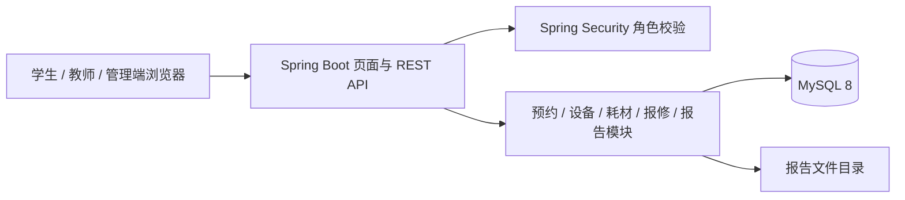
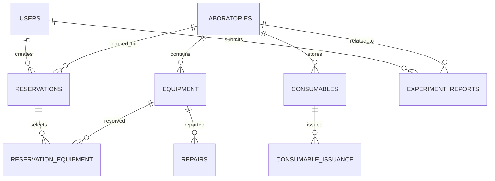
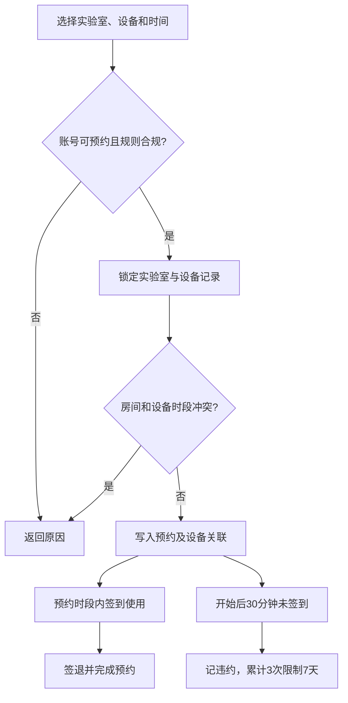
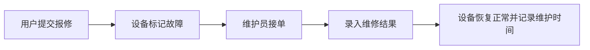
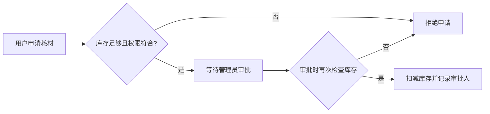

# 系统设计与验证方案

## 架构

## 核心数据关系

设备预约关系单独使用 `reservation_equipment`，避免把多个设备 ID 塞在 JSON 字段里，便于冲突检查和外键约束。

## 预约流程

## 报修和耗材流程

## 功能验证用例

| 编号 | 场景 | 操作 | 预期结果 |
|---|---|---|---|
| B-01 | 学生预约 2 小时 | 选择空闲实验室及正常设备 | 建立待使用预约 |
| B-02 | 学生预约 4 小时以上 | 提交超时段申请 | 返回预约时长超限 |
| B-03 | 房间重复时段 | 对同一实验室提交重叠预约 | 后一个请求被拒绝 |
| B-04 | 设备重复时段 | 同一设备重叠预约不同房间 | 因设备归属/占用校验拒绝 |
| B-05 | 预约开始前不足 1 小时取消 | 提交取消请求 | 拒绝取消 |
| B-06 | 三次未签到 | 等待预约开始 30 分钟后检查 | 违约次数累计并禁约 7 天 |
| R-01 | 用户提交报修 | 选设备并填写故障说明 | 建立待处理报修，设备标故障 |
| R-02 | 维护员完成维修 | 填维修内容 | 报修完成，设备恢复正常 |
| C-01 | 库存不足申请 | 申请超过可用库存 | 申请被拒绝 |
| C-02 | 管理员审批后库存 | 审批通过 | 库存扣减，领用单标记已通过 |
| P-01 | 学生打开管理写接口 | 使用学生账号新增设备 | 返回 403 |
| P-02 | 上传不支持格式 | 上传可执行文件 | 返回 400 |

性能要求“100 人同时预约”和“响应时间小于 1 秒”需要在目标服务器上使用 JMeter/Gatling 等工具压测；项目没有伪造压测数据。数据库通过实验室类型/地点、设备所属实验室/状态、预约时间和用户状态索引支持常见查询。
